  

I'm Ibro, a frontend engineer from Tashkent. For five years I've worked on large Angular and React codebases for teams at EPAM and Vention, mostly on the parts other developers depend on: shared component libraries, microfrontend shells, framework migrations, and the test and lint gates that keep a big codebase sane.

My portfolio is a Storybook. Every item in it is a real Angular component with controls and docs.

**[Open my Storybook →](https://ibro-makhmudov.github.io/stories/?path=/story/hello--recruiter)**

| story | what it shows |
|---|---|
| `Hello / Recruiter` | a greeting that takes the team name from the link: `&args=company:YourTeam` |
| `Experience / Roles` | Vention and EPAM, project by project |
| `Built / Microfrontend shell` | a model of a Module Federation host: toggle remotes and shared singletons, see what loads |
| `Built / Shared UI library` | a small design-system slice with autodocs and an interaction test |
| `Built / Angular 10 → 14` | how a live migration was rolled out, one major at a time |

ibrokhimkhuja.makhmudov@gmail.com · <a href="https://www.linkedin.com/in/ibro-makhmudov/">LinkedIn</a> · source: <a href="https://github.com/ibro-makhmudov/stories">stories</a>
